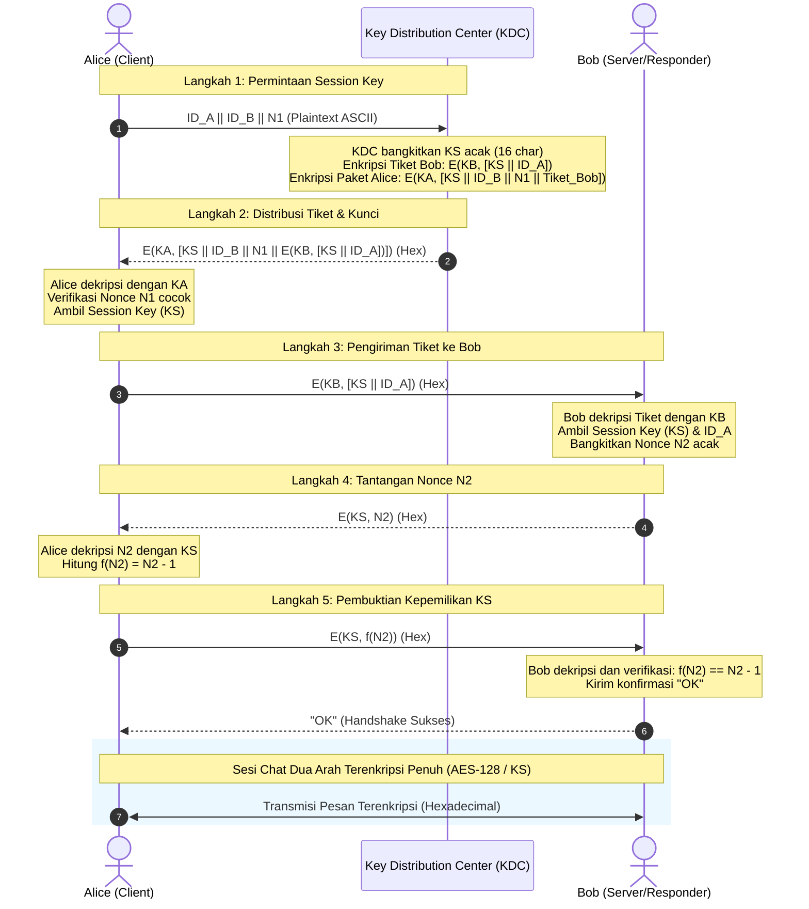

# AES-128 Manual & KDC Socket Chat (3 Entitas)

[](https://www.python.org/)
[-brightgreen.svg)](#arsitektur-kriptografi)
[](#alur-protokol-5-langkah)
[-success.svg)](#kepatuhan-spesifikasi)

Repositori ini memuat implementasi mandiri (*pure manual implementation*) algoritma **Advanced Encryption Standard (AES-128)** dan protokol **Key Distribution Center (KDC)** 5-langkah (Skenario William Stallings) untuk komunikasi dua arah (*full-duplex*) berbasis TCP Socket antara 3 entitas terpisah: **KDC**, **Alice**, dan **Bob** pada host/IP berbeda.

Proyek ini dibangun untuk memenuhi **Tugas 2 Mata Kuliah Keamanan Informasi** dengan kepatuhan penuh tanpa menggunakan library kriptografi siap pakai (seperti `pycryptodome`, `cryptography`, atau `hashlib`).

---

## Daftar Isi
- [Kepatuhan Spesifikasi](#kepatuhan-spesifikasi)
- [Arsitektur Kriptografi](#arsitektur-kriptografi)
- [Alur Protokol 5-Langkah](#alur-protokol-5-langkah)
- [Struktur Repositori](#struktur-repositori)
- [Panduan Penggunaan](#panduan-penggunaan)
  - [Skenario A: Demo pada 1 Mesin (Localhost)](#skenario-a-demo-pada-1-mesin-localhost)
  - [Skenario B: Demo pada 3 Mesin / IP Berbeda](#skenario-b-demo-pada-3-mesin--ip-berbeda)
- [Panduan Analisis Wireshark](#panduan-analisis-wireshark)
- [Fitur Tambahan & Robustness](#fitur-tambahan--robustness)
- [Verifikasi Standar Resmi](#verifikasi-standar-resmi)
- [Authorship](#authorship)

---

## Kepatuhan Spesifikasi

| Kebutuhan Spesifikasi | Status | Implementasi & Lokasi Kode |
|:---|:---:|:---|
| **Tanpa Library Kripto** | ✅ Lolos | Seluruh operasi AES (S-Box, Galois Field, Key Schedule, Round Transformations) ditulis manual murni di [`aes.py`](aes.py). |
| **KDC 3 Entitas Terpisah** | ✅ Lolos | Proses independen: KDC ([`kdc.py`](kdc.py)), Alice ([`alice.py`](alice.py)), dan Bob ([`bob.py`](bob.py)). |
| **Skenario Stallings 5-Langkah** | ✅ Lolos | Implementasi lengkap: Nonce $N_1$, Tiket Bob berlapis, tantangan $N_2$, dan verifikasi $f(N_2) = N_2 - 1$. |
| **Komunikasi Dua Arah** | ✅ Lolos | Menggunakan threading full-duplex di [`chat.py`](chat.py); Alice dan Bob dapat mengirim dan menerima pesan secara simultan. |
| **Format Data** | ✅ Lolos | Plaintext dan kunci berformat ASCII, seluruh ciphertext ditransmisikan dan ditampilkan dalam representasi Heksadesimal. |
| **Kunci Dinamis (Runtime)** | ✅ Lolos | Kunci Master ($K_A, K_B$) dan Session Key ($K_S$) dapat diubah langsung melalui menu terminal interaktif tanpa perlu restart program. |
| **Dukungan Beda IP** | ✅ Lolos | Konfigurasi fleksibel menggunakan `argparse` CLI; tidak ada pemanggilan `bind()` sepihak pada soket client. |
| **Wireshark Observability** | ✅ Lolos | Port 5000 (KDC) dan 5002 (Bob) terisolasi dan mudah difilter; transmisi payload heksadesimal terbaca jelas pada TCP stream. |

---

## Arsitektur Kriptografi

Implementasi AES-128 di [`aes.py`](aes.py) mengikuti spesifikasi resmi **NIST FIPS-197**:

```
Plaintext (ASCII) ──► PKCS#7 Padding ──► Blok 16 Byte (State 4x4)
                                                │
                 ┌──────────────────────────────┴──────────────────────────────┐
                 ▼                                                             ▼
           [ Putaran 0 ]                                              [ Putaran 1 s.d. 9 ]
     AddRoundKey(State, RK_0)                                   1. SubBytes(S-Box)
                                                                2. ShiftRows
                                                                3. MixColumns (GF 2^8)
                                                                4. AddRoundKey(State, RK_i)
                                                                               │
                                                                               ▼
                                                                        [ Putaran 10 ]
                                                                 1. SubBytes(S-Box)
                                                                 2. ShiftRows
                                                                 3. AddRoundKey(State, RK_10)
                                                                               │
Ciphertext (Hexadecimal) ◄── Bytes to Hex ◄── Matrix to Bytes ◄────────────────┘
```

### Komponen Inti:
1. **Galois Field $GF(2^8)$ Arithmetic (`gmul`):** Perkalian biner berbasis algoritma *Russian Peasant* dengan reduksi modulo terhadap polinomial tak tereduksi (*irreducible polynomial*) $m(x) = x^8 + x^4 + x^3 + x + 1$ (XOR `0x1B` saat bit ke-7 overflow).
2. **Key Expansion:** Membangkitkan 11 round keys (176 byte) dari 16 byte master key melalui `RotWord`, `SubWord` (S-Box), dan XOR `Rcon` (Round Constant).
3. **PKCS#7 Padding:** Menjamin blok data selalu kelipatan 16 byte; melempar exception jika data dekripsi rusak atau kunci salah.
4. **Mode Operasi ECB & CBC:** Mendukung mode ECB standar dan mode CBC dengan *Initialization Vector* (IV) acak 16-byte yang disematkan di depan ciphertext.

---

## Alur Protokol 5-Langkah

Protokol pertukaran kunci mengikuti skenario standar **William Stallings (Cryptography and Network Security)**:



---

## Struktur Repositori

```
AES128_KDC_SocketChat/
├── aes.py          # Implementasi manual inti AES-128 (ECB/CBC, Key Schedule, GF 2^8, PKCS#7)
├── kdc.py          # Entitas Key Distribution Center (Server Port 5000)
├── bob.py          # Entitas Bob (Responder & Server Chat Port 5002)
├── alice.py        # Entitas Alice (Inisiator Skenario KDC & Client Chat)
├── chat.py         # Helper sesi komunikasi dua arah full-duplex dan TCP framing
├── README.md       # Dokumentasi utama proyek
└── .gitignore      # Daftar file yang diabaikan oleh Git
```

---

## Panduan Penggunaan

### Prasyarat
- **Python 3.8** atau versi yang lebih baru.
- Tidak memerlukan instalasi paket tambahan (`pip install` tidak diperlukan).

---

### Skenario A: Demo pada 1 Mesin (Localhost)

Buka **3 jendela terminal** terpisah, lalu jalankan dengan urutan berikut:

1. **Terminal 1 (KDC):**
   ```bash
   python kdc.py
   ```
2. **Terminal 2 (Bob):**
   ```bash
   python bob.py
   ```
   Pilih menu `1` (*Siaga Terima Koneksi & Chat dari Alice*).
3. **Terminal 3 (Alice):**
   ```bash
   python alice.py
   ```
   Pilih menu `1` (*Mulai Skenario KDC & Chat dengan Bob*).
4. **Sesi Chat:**
   Ketik pesan di terminal Alice atau Bob lalu tekan `Enter`. Ketik `/menu` untuk keluar dari sesi chat.

---

### Skenario B: Demo pada 3 Mesin / IP Berbeda

Contoh alokasi IP:
- **KDC Server**   : `192.168.1.10`
- **Bob (Server)** : `192.168.1.20`
- **Alice (Client)**: `192.168.1.30`

Jalankan perintah berikut pada masing-masing mesin:

1. **Pada Mesin KDC (`192.168.1.10`):**
   ```bash
   python kdc.py --host 0.0.0.0 --port 5000
   ```
2. **Pada Mesin Bob (`192.168.1.20`):**
   ```bash
   python bob.py --host 0.0.0.0 --port 5002
   ```
   Pilih menu `1` untuk mulai mendengarkan koneksi masuk.
3. **Pada Mesin Alice (`192.168.1.30`):**
   ```bash
   python alice.py --kdc-host 192.168.1.10 --kdc-port 5000 --bob-host 192.168.1.20 --bob-port 5002
   ```
   Pilih menu `1` untuk mengeksekusi handshake 5-langkah dan memulai percakapan aman.

---

## Panduan Analisis Wireshark

### 1. Konfigurasi Capture
- Buka Wireshark dan pilih antarmuka jaringan yang aktif (misal `Wi-Fi`, `Ethernet`, atau `Adapter for loopback traffic capture` jika dijalankan lokal).
- Terapkan **Display Filter**:
  ```wireshark
  tcp.port == 5000 || tcp.port == 5002
  ```

### 2. Checklist Paket yang Teramati

| Tahap | Protokol / Port | Arah | Payload yang Teramati | Keterangan |
|:---:|:---:|:---:|:---|:---|
| **Langkah 1** | TCP / 5000 | Alice -> KDC | `ALICE\|BOB\|<N1>` (ASCII Plaintext) | Permintaan Session Key secara terbuka. |
| **Langkah 2** | TCP / 5000 | KDC -> Alice | String Heksadesimal (~192 Karakter Hex) | Paket terenkripsi $K_A$ berisi $K_S, N_1$, dan Tiket Bob. |
| **Langkah 3** | TCP / 5002 | Alice -> Bob | String Heksadesimal (~64 Karakter Hex) | Tiket Bob $E(K_B, [K_S \| ID_A])$ diteruskan oleh Alice. |
| **Langkah 4** | TCP / 5002 | Bob -> Alice | String Heksadesimal (32 Karakter Hex = 1 Blok) | Tantangan Nonce $N_2$ terenkripsi $K_S$. |
| **Langkah 5** | TCP / 5002 | Alice -> Bob | String Heksadesimal (32 Karakter Hex) | Respon verifikasi $f(N_2) = N_2 - 1$ terenkripsi $K_S$. |
| **ACK** | TCP / 5002 | Bob -> Alice | `OK` (ASCII) | Konfirmasi verifikasi nonce sukses. |
| **Chat 2-Arah** | TCP / 5002 | Alice <-> Bob | String Heksadesimal (Kelipatan 32 char) | Percakapan terenkripsi penuh tanpa kebocoran plaintext. |

> **Tips:** Klik kanan salah satu paket port 5002 -> Pilih **Follow** -> **TCP Stream**. Anda akan melihat seluruh dialog percakapan terselubung dalam format heksadesimal acak.

---

## Fitur Tambahan & Robustness

1. **TCP Stream Framing:**
   Setiap transmisi data diakhiri dengan delimiter newline `\n` ([`chat.py`](chat.py)). Ini mencegah masalah umum penggabungan paket (*packet coalescing*) akibat algoritma Nagle pada transmisi TCP cepat.
2. **Validasi Ketat Panjang Kunci:**
   Masukan kunci ASCII divalidasi tepat 16 byte (128 bit) di seluruh menu interaktif. Program secara tegas menolak kunci yang terlalu pendek atau panjang tanpa *silent padding/truncation*.
3. **Pilihan Mode Operasi (ECB & CBC):**
   Pengguna dapat mengganti mode enkripsi antara ECB dan CBC langsung dari menu interaktif. Mode CBC menggunakan IV acak 16-byte untuk menjamin *semantic security*.
4. **Mode Verbose Inspeksi Matriks State:**
   Tersedia opsi *Toggle Mode Verbose* pada menu Alice dan Bob untuk mencetak matriks state $4 \times 4$ setelah tiap transformasi pada Round 1 dan Round 10 saat demo.
5. **Penutupan Soket Bersih:**
   Seluruh siklus soket dikelola menggunakan context manager `with` dan blok `finally` guna mencegah kebocoran file descriptor saat terjadi kegagalan jaringan.

---

## Verifikasi Standar Resmi

Algoritma AES-128 pada repositori ini telah diverifikasi secara formal terhadap vektor uji standar industri:

1. **NIST FIPS-197 Appendix C.1 (Single Block):**
   - **Key:** `000102030405060708090a0b0c0d0e0f`
   - **Plaintext:** `00112233445566778899aabbccddeeff`
   - **Expected Ciphertext:** `69c4e0d86a7b0430d8cdb78070b4c55a`
   - **Status:** **MATCH (100% Lolos)**
2. **NIST SP 800-38A (ECB-AES128 & CBC-AES128 Multi-Block):**
   - **Key:** `2b7e151628aed2a6abf7158809cf4f3c`
   - **IV (CBC):** `000102030405060708090a0b0c0d0e0f`
   - **Status:** **MATCH (100% Lolos)**

---

## Authorship

- **Nama:** Muhammad Adi Anugerah Arrahman (Nugi Arrahman)
- **NRP:** 5025241118
- **Program Studi:** Teknik Informatika, Institut Teknologi Sepuluh Nopember (ITS)
- **Mata Kuliah:** Keamanan Informasi (Tugas 2)
